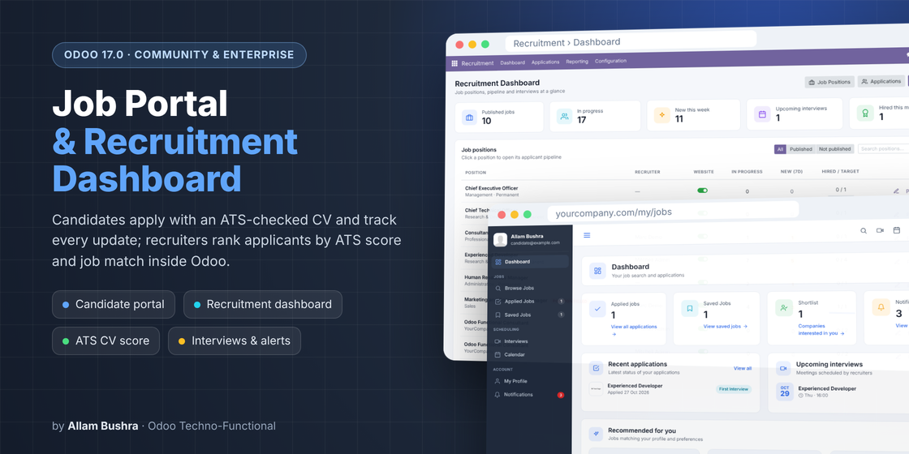
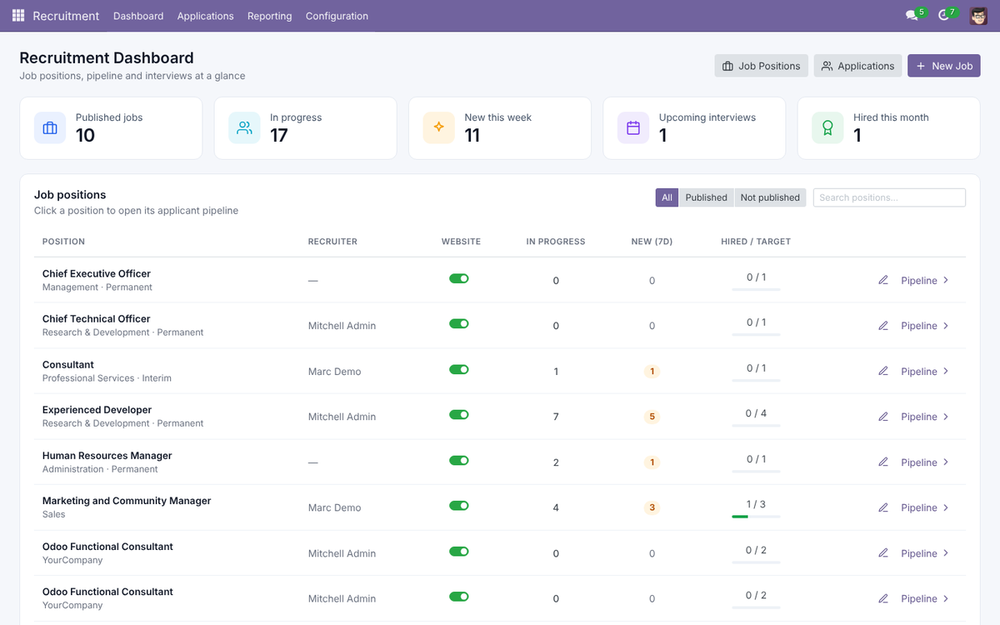
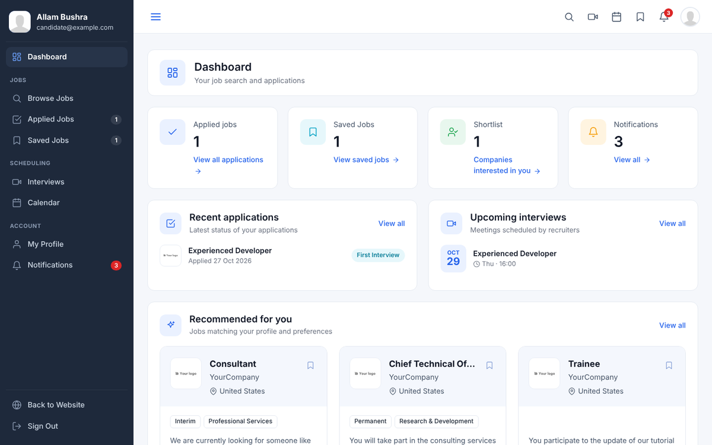

# Odoo Job Portal & ATS



A complete recruitment experience for **Odoo 17** (this branch) and **Odoo 20** (branch [`20.0`](../../tree/20.0)), Community & Enterprise:

- a **candidate self-service portal** on the website where job seekers sign up, apply and follow every update,
- an **ATS (Applicant Tracking System) CV check** that scores every résumé and matches it against the job,
- a **Recruitment Dashboard** inside Odoo for recruiters.

Module technical name: **`aa_job_portal`**

---

## Features

### Candidate portal (website, `/my/jobs`)
- Free sign-up from the website; job seekers land on their own dashboard.
- Dashboard counters: applications, saved jobs, shortlisted, unread notifications.
- Recommended jobs ranked against the candidate's desired position and skills.
- Browse and search published jobs, save them, and apply in one step with the profile CV.
- Applied jobs with live, candidate-friendly status (In progress / Shortlisted / Closed).
- Interviews list with *Join* button and a monthly calendar.
- In-portal notifications when an application is submitted, changes stage, is shortlisted, hired or not selected, and when an interview is scheduled or rescheduled.
- Candidate profile (phone, LinkedIn, desired position, experience, skills, location, CV) with a verification step.
- Welcome popup once per sign-in and a highlighted **Candidate Dashboard** menu button (hidden for visitors).

### ATS CV score
- Every CV (portal, website form, email or backend upload) is scored **out of 100** against ATS-compliant résumé rules:
  - **File & format** – text-based PDF/DOCX, readable text (scanned files fail), size, professional file name
  - **Contact details** – e-mail, phone, name at the top, LinkedIn/portfolio link
  - **Standard sections** – Experience, Education, Skills, Summary, Certifications/Projects/Languages (English & Arabic headings)
  - **Layout** – no tables, photos, text boxes, multiple columns or contact details in headers/footers; standard fonts
  - **Content** – 1–2 pages, dated roles, bullet points, action verbs, quantified results, no unnecessary personal data
- **Job match %** – keywords from the job title and description found / missing in the CV.
- Candidates get a full report with prioritised fixes and can upload an improved CV to re-check instantly.
- Recruiters see the score on the applicant form (*ATS Check* tab), in the applicant list, in search filters and on the dashboard.
- Pure Python: PDF through the PDF library shipped with Odoo, DOCX/ODT parsed directly — **no extra dependencies**.

### Recruitment rules
- **One application per candidate and job** – duplicates are blocked on the portal, the public `/jobs` apply page and the website form.
- **Position filled** – when a job's *Target* is reached it shows a *Position Filled* ribbon, stops accepting applications everywhere, and recruiters cannot hire beyond the target.

### Recruitment Dashboard (inside Odoo)
- Opens when recruiters click the **Recruitment** app.
- KPIs: published jobs, applications in progress, new this week, upcoming interviews, hired this month.
- Job positions table with website publish switch, pipeline size, new applicants and hired vs. target.
- Pipeline by stage, latest applications (with ATS score) and upcoming interviews.
- Every item opens the standard Odoo views with breadcrumbs back to the dashboard.





---

## Requirements
- Odoo **17.0** (Community or Enterprise)
- Dependencies (standard Odoo): `website_hr_recruitment`, `portal`, `auth_signup`, `calendar`

## Installation
1. Copy the `aa_job_portal` folder into your custom addons path.
2. Restart Odoo.
3. *Apps* → *Update Apps List* → search **Job Portal** → *Install*.

## Upgrading to a new version
Always run the module upgrade after replacing the files — new versions may add database columns:

```bash
# stop Odoo first, replace the aa_job_portal folder, then:
odoo-bin -c /etc/odoo/odoo.conf -d <your_database> -u aa_job_portal --stop-after-init
# start Odoo again
```

## Configuration
1. Publish job positions on the website (*Recruitment › Job Positions › Is Published*).
2. *Recruitment › Configuration › Stages*: tick **Shortlisted in Candidate Portal** on shortlist stages and optionally set a **Candidate-facing Label**.
3. *Recruitment › Settings*: keep **Candidate Dashboard** on so job seekers opening `/my` land on `/my/jobs`.
4. Give recruiters the **Recruitment › Officer** or **Administrator** right — the Recruitment app then opens on its Dashboard.

## Security notes
- Candidates only see applications linked to their own contact (never matched by e-mail).
- Portal users have no direct access to the module's models; the recruiter dashboard runs with each user's own access rights, so record rules and multi-company settings apply.

---

## Branches
| Branch | Odoo version |
|--------|--------------|
| `17.0` | Odoo 17 |
| `20.0` | Odoo 20 |

## Author
**Allam Bushra** — ERP System Specialist | Odoo Techno-Functional Consultant
[LinkedIn](https://www.linkedin.com/in/lomixyz/) · [GitHub](https://github.com/lomixyz)

## License
[LGPL-3](https://www.gnu.org/licenses/lgpl-3.0.html)
